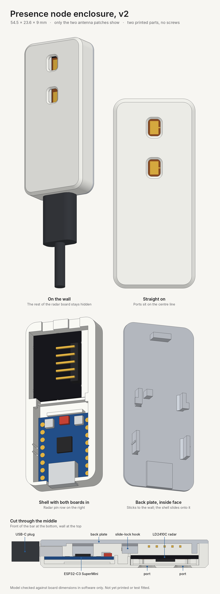
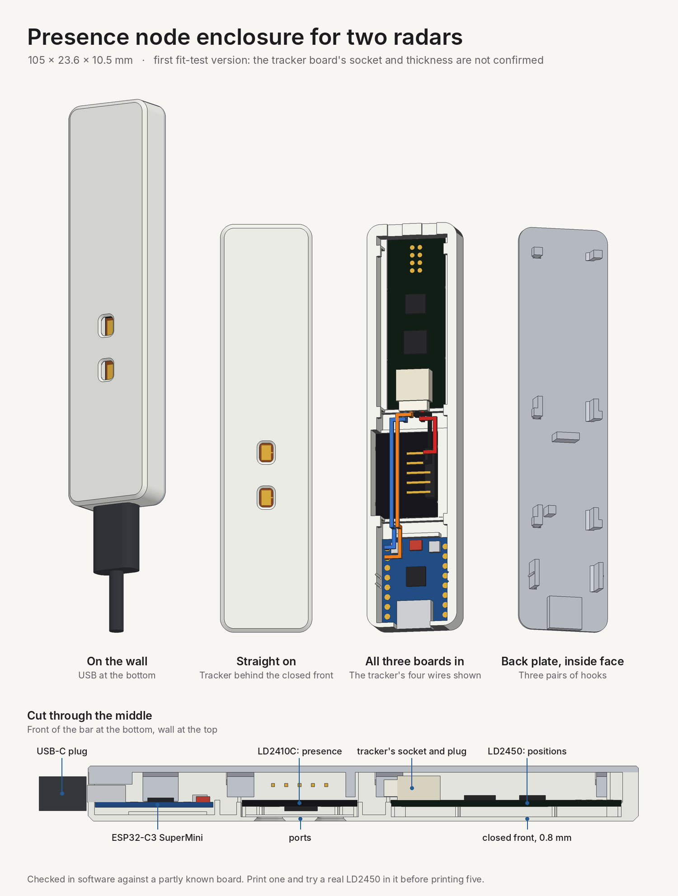
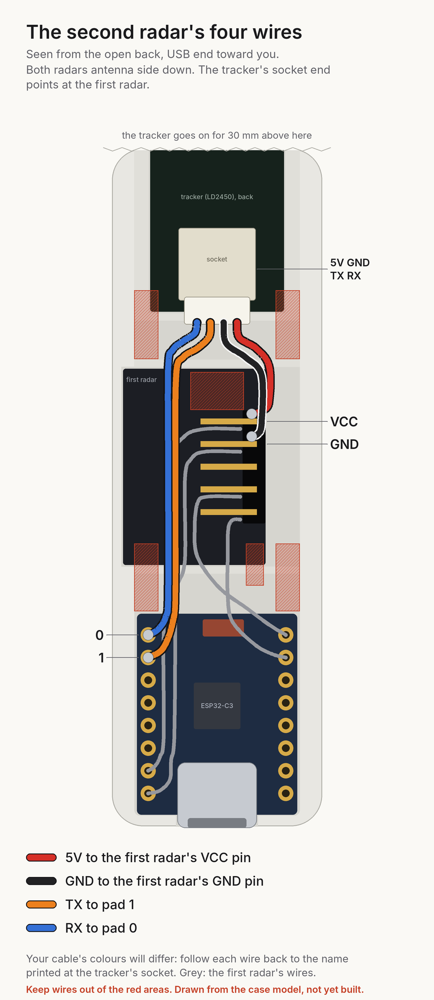

# Presence node enclosure (version 2)

A slim wall bar for one presence node: an HLK-LD2410C radar and an ESP32-C3 SuperMini.
54.5 × 23.6 × 9.0 mm, two printed parts, no supports, no screws, about 7 g of filament.

The front is closed except for two small ports, 3.55 × 4.9 mm, one over each of the radar's
antenna patches. The rest of the radar board is hidden.

**Status: designed and checked in software. Not printed, not test fitted.** Print one and try
the fit before printing four. Every dimension is a named parameter in `enclosure.py`.

Version 2 is 1.8 mm wider than the first design and has its own back plate. Files without `v2`
in the name belong to the first design and do not fit these.

## Files

| File | Use |
|---|---|
| `print/presence-v2-shell.stl` | The shell with the two ports. Start here. |
| `print/presence-v2-back.stl` | The back plate. Fits both shells. |
| `print/presence-v2-both.3mf` | Those two parts, laid out to print together |
| `print/presence-v2-plate-x5.3mf` | Five shells and five back plates as ten separate objects, 8 mm apart, laid out on a 256 mm bed. It needs 150 × 119 mm. |
| `print/presence-v2-shell-closed.stl` | The same shell with no ports: 0.8 mm of plastic over the whole radar |
| `print/*.step` | For editing in CAD. `presence-v2-assembly.step` adds simple models of the two boards. |
| `enclosure.py` | The model (CadQuery). `python enclosure.py` rebuilds everything in `print/`. |
| `check.py` | 40 fit, lock, port and printability checks: `python check.py ports`. Results in `print/check-results*.json`. |
| `print/presence-duo-*` | The long bar for two radars. See [its section](#the-long-bar-for-two-radars-first-fit-test-version) before printing it. |

## Check your radar against the ports first

The ports are placed from measurements off a photo of one LD2410C, good to about 0.3 mm. Before
printing four, lay a ruler on yours. With the antenna side up and the pin row along the top, the
two gold patches should be:

- 2.45 mm tall and 3.8 mm wide,
- centred 5.45 mm down from the pin-row edge,
- centred 5.3 mm and 16.9 mm from the left-hand (TX) end.

If yours differ, change `patch_v`, `patch_u`, `patch_w` and `patch_l` in `enclosure.py`. The
radar's pocket moves with them, so the ports stay on the bar's centre line. A smaller `patch_v`
pushes the pocket further into the side wall; `check.py` fails if less than 1 mm of wall is left,
and a larger `wall` fixes that.

## Print

- **PETG.** The boards give off roughly half a watt in a closed 10 cm³ case, and PLA creeps when
  warm. ASA also works. No carbon-fibre or metal-filled filament: the radar looks through the front.
- 0.4 mm nozzle, 0.2 mm layers, 3 walls, no supports, no brim. Heights in the model sit on the
  0.2 mm layer grid.
- Keep the orientation in the files: shell with its front face on the bed (the bed surface becomes
  the visible face), back plate with its wall side on the bed.
- Nothing overhangs by more than 45°, and nothing bridges.

## Prepare the boards

**Radar pins.** Many LD2410C modules arrive with a five-pin header soldered on. Straight pins do
not fit in 9 mm. Fold the five pins flat toward the middle of the board with pliers, or snip them
off close to the black plastic. If the pin tips on the antenna side stand more than 1.8 mm proud,
snip those too. A module with bare holes needs none of this: solder the wires straight in.

**Four wires**, 28 to 30 AWG, cut to fit with the boards lying in the shell: about 60 mm for VCC, 55 mm for GND and 35 mm each for TX and RX.

| Radar | ESP32-C3 SuperMini |
|---|---|
| VCC | 5V |
| GND | GND |
| TX | GPIO20 (RX) |
| RX | GPIO21 (TX) |

OUT stays empty.

- On the radar, solder each wire beside its folded pin, not on top of it. There is 0.6 mm above
  the pins.
- On the C3, bring the wires in from the component side.
- Keep wire and solder off the four middle pads of each row on the C3 (pads 3 to 6, counted from
  the USB end). Two tabs of the back plate land there. The pads you need are the outer ones: 5V and
  GND beside the USB-C socket, GPIO20 and GPIO21 at the antenna end.

Flash the firmware over USB before you close it up. The port stays reachable afterwards too.

## Assemble

Hold the shell open side up, with the USB notch toward you.

1. **Radar**: antenna side down into the pocket at the far end, **pin row on the right**. The
   pocket is off centre and runs into the left wall; that is what puts the patches under the ports.
   Press until the board sits on the four corner rests. Four small ribs grip its edges.
2. Turn the shell over and look through the ports. Each should show a gold rectangle. If they show
   bare board, the radar is turned round.
3. **C3**: components facing you, USB-C socket into the notch in the near end wall. The socket
   rests on the notch and the board hangs from it, so the thickness of the board does not matter.
4. Lay the wires down the middle. Keep them away from the side walls between the two boards: the
   back plate's two hooks go there.
5. **Back plate**: lay it on about 2.4 mm low, so its bottom edge overhangs the USB end. It drops
   flat only in that position. Slide it toward the radar end until it clicks and the edges are
   flush.

## Mount

- Foam tape or a small Command strip on the back plate.
- **USB end down**, or sideways. Never USB end up: gravity keeps the slide lock shut.
- To be able to take the bar off later, stick the plate to the wall on its own. Hold the bar
  2 to 3 mm high, press it flat onto the plate and slide it down until it clicks.
- Plug the cable in last, holding the bar with the other hand. The plug then sits where the plate
  would have to go for the bar to slide back up, so the cable locks the bar on. Unplug to remove.
- Height and aim: the radar's manual asks for 1.5 to 2 m up the wall, facing the part of the room
  people use.

## The long bar for two radars (first fit-test version)

`presence-duo-*` is the same bar made longer for a second radar: an HLK-LD2450, which tracks where
people are for the app's room map. It is 104.9 × 23.6 × 10.5 mm and mounts upright, USB end down.

- The ESP32-C3 and the LD2410C sit exactly where they sit in the short bar, on the same four wires.
  A node built in the short case moves over as it is.
- The LD2450 sits above them behind a closed 0.8 mm front, antenna side toward the room, socket end
  toward the LD2410C.
- Three pairs of hooks hold the shell to the back plate instead of one. It closes the same way:
  set the back plate on 2.4 mm toward the USB end, slide it home, plug the cable in.
- It is 1.5 mm deeper than the short bar, for the LD2450's socket.

| File | Use |
|---|---|
| `print/presence-duo-shell.stl` | The shell: ports over the LD2410C's patches, closed over the LD2450 |
| `print/presence-duo-back.stl` | Its back plate |
| `print/presence-duo-fit-test.3mf` | One shell and one back plate as two objects, laid out on a 256 mm bed. Print this first. |
| `print/presence-duo-both.3mf` | The same two parts as a single object |
| `print/presence-duo-shell-closed.stl` | The same shell with no ports |
| `print/presence-duo-plate-x5.3mf` | Five sets as ten separate objects on a 256 mm bed (150 × 220 mm). For after the fit test. |

### Print one and try a real LD2450 in it before printing more

Hi-Link publishes the board's outline, 44 × 15 mm, and nothing else about its shape. The rest of
what this case assumes comes from a hobbyist's 3D model of the board, or is a guess:

| Assumed | From | If yours differs |
|---|---|---|
| The socket is 4.6 mm tall and sits 1.25 to 9.4 mm in from one short edge | the 3D model | `trk_sock`, `trk_sock_h`, `depth` |
| The cable's plug goes in along the board, so the wires leave past that short edge | a guess | see step 2 |
| Nothing else on the back is taller than the socket | the 3D model | `depth` |
| The PCB is 1.0 to 1.6 mm thick | a guess | `rad_t_max` |
| The antenna side is bare at its four corners | a guess | the rests cover 0.9 mm of each corner |

When the board arrives:

1. Lay it in its pocket, antenna side down, socket end toward the first radar. It should press past
   the six small ribs and sit flat on its four corners.
2. Plug the cable in. If the wires leave along the board, past its short edge, it fits. If the plug
   goes in from the back and the wires stand up off the board, it will not fit under the back
   plate: leave the cable off and solder four wires to the holes marked 5V, GND, TX and RX at the
   board's other end.
3. A board that came with pins soldered into those holes needs them snipped flush first.
4. Close the case with the cable unplugged. If the plate will not sit down, something on the board
   is taller than 4.6 mm: raise `depth` by the difference and rebuild.

Kits come with a small 2.4 GHz antenna on a lead. It serves the radar's own Bluetooth, which only
Hi-Link's phone app uses. The case has no place for it and the radar works without it: leave it
off, and clip it on for a firmware update if one is needed.

### The second radar's four wires

| LD2450 | Goes to |
|---|---|
| 5V | The LD2410C's VCC pin, on top of the wire already there |
| GND | The LD2410C's GND pin, the same way |
| TX | ESP32-C3 pad 1 (GPIO1) |
| RX | ESP32-C3 pad 0 (GPIO0) |

The names are printed on the LD2450 at its socket; cable colours vary, so follow each wire back to
its name. Cut 5V and GND to about 20 mm from the plug and TX and RX to about 50 mm, a little long
at first. TX and RX run down the left side over the LD2410C's bare back; 5V and GND turn right to
its pin row. The back plate's posts come down in the red areas of the picture, in both of its
positions, so keep wires and solder out of them. Pads 1 and 0 are the last two on the ESP32-C3's
left row, at its antenna end; go by the numbers printed on your board.

### Which way up

Upright on the wall, USB end down, 1.5 to 2 m above the floor. The LD2450 tells left from right
across its short side, so a bar mounted sideways maps a room wrongly. Nothing published says which
end of the board is up. It does not matter: the other way up only swaps left and right, and the
app's map has a switch for that.

## What the ports do for the radar

The radar's manual asks for a cover that is half a wavelength thick or else no more than about an
eighth, and for one or one and a half wavelengths of air (12.4 or 18.6 mm) between the antennas
and the cover where space allows. A 9 mm case cannot give that air.

- **With ports**, each patch looks straight out through open air. To the sides, past about 15°
  from a patch edge, the signal still crosses the 0.8 mm front, which keeps the thickness rule.
- A thin wall, the baffle, stands beside the ports on the pin side and stops 0.2 mm short of the
  board. It hides the board's printed lettering when you look in from the side. It is plastic
  0.55 mm from one edge of each patch. To leave it out, set `port_baffle = False`.
- **The closed shell** has 0.8 mm of plastic over the whole radar, 2 mm in front of it.
- None of this has been measured. Both shells fit the same back plate, so print both, turn on
  engineering mode and compare the gate energies. Set the gate thresholds after the node is
  assembled and on the wall, not on the bench.
- For more air behind either front, raise `air_gap` and `depth` by the same amount in
  `enclosure.py` and reprint.

The C3's red power LED faces the wall. With light filament, or through the ports in a dark room,
a faint glow can show; a bit of opaque tape over the LED fixes that.

## If a fit is off

| What happens | Quick fix | Parameter in `enclosure.py` |
|---|---|---|
| Patches sit off centre in the ports | | `patch_u`, `patch_v` |
| Radar will not sit flat on its rests | Something on your board touches the baffle: slice it off with a knife | `port_baffle = False` |
| Radar will not press in | Shave the four ribs with a knife | `pocket_clear` 0.2 to 0.3 |
| Radar is loose | A dot of hot glue at one corner | Rib height `h` in `make_shell` |
| Back plate will not slide, or is very stiff | Sand the two barbs and the two round ribs | `fit` 0.2 to 0.3 |
| Back plate rattles | | `fit` 0.2 to 0.15 |
| C3 does not drop in | | `side_clear`, `c3_end_clear` |
| USB-C plug does not click fully home | | `wall_usb` 1.2 to 1.0, or `usb_overhang` |
| Radar PCB thicker than 1.6 mm | | `rad_t_max` |

## What the checks cover

`check.py` builds one shell, the back plate and simple models of the two boards, then confirms that:

- both boards lower straight in and sit without touching the shell, for C3 boards 0.6, 1.0 and
  1.6 mm thick and for the radar's pins folded, cut or absent;
- the back plate lowers on in the parked position and slides to locked without touching the shell
  or either board;
- locked, the catches stop the plate lifting after 0.2 mm of play, and parked it lifts freely;
- the pad over the USB-C socket and the tabs over the C3 sit 0.14 and 0.2 mm above them, and the
  back stops sit 0.2 to 0.8 mm behind radar boards 1.6 to 1.0 mm thick;
- the radar rests on its four corner supports, and 1 mm tall radar parts and 1.8 mm solder tails
  clear the front;
- each patch shows whole through its port, the ports sit on the centre line, and the lettering,
  the pin tips and the radar chip stay hidden when seen straight on;
- a USB-C plug up to 7 mm thick stays inside the bar's profile, clears the locked plate and
  blocks the slide back to parked;
- neither part has an overhang beyond 45°, and both exported meshes are closed.

For the long bar (`python check.py duo`, 53 checks; `duo-closed`, 47) it also confirms that:

- the LD2450's board model lowers straight in, sits on four corner rests and is gripped by its ribs,
  for PCBs 1.0, 1.2 and 1.6 mm thick;
- the back plate slides from parked to locked without touching that board, its socket or its plug,
  and all three pairs of catches hold;
- the plate stands only over the outer 0.7 mm of the LD2450's long edges, 0.2 to 0.8 mm behind the
  board, and the socket clears the plate by 0.3 mm on a 1.6 mm board;
- two lanes stay free for the four new wires with the plate parked and locked.

It does not cover: a real print, real boards (clones and board revisions vary), what the front
and the baffle do to the radar's range, how warm the inside gets, or whether two 24 GHz radars
in one case disturb each other. For the long bar the LD2450 itself is the open question: every
check above is against a model of a board nobody here has held.
