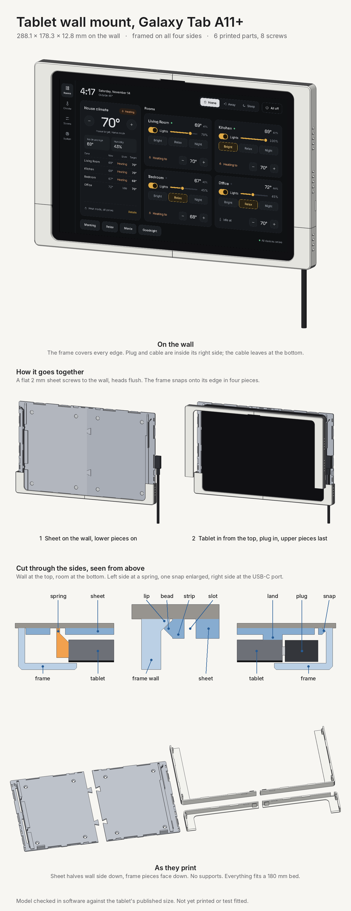

# Tablet wall mount

A wall mount that frames the control-center tablet on all four sides: a Samsung Galaxy Tab A11+ in
landscape. The Tab A9+ has the same body and fits too. 288.1 × 178.3 × 12.8 mm on the wall, six
printed parts, no supports, eight wall screws, about 180 g of filament.

A flat 2 mm sheet screws to the wall with countersunk screws, heads flush. It carries the feet the
tablet stands on, the stops beside it and two printed springs. A frame in four corner pieces snaps
onto the sheet's edge and closes the tablet in. The charging plug and its cable sit inside the
right side of the frame, so the only cable you see is the one leaving the bottom.

**Status: designed and checked in software. Not printed, not test fitted.** Print
`back-right` and `frame-top-right` first. Together they show how the tablet's edge, your plug and
three of the snaps fit before you print the rest. Every dimension is a named parameter in `mount.py`.

## What it relies on, and what it does not

The published dimensions give the tablet's outside size, 257.1 × 168.7 × 6.9 mm, but not where the
port, buttons or camera sit. So the mount is built to need as little as possible.

- The frame reaches 2.5 mm over the glass on every side, on a bezel about 10 mm wide. At the
  front camera it reaches 1 mm.
- The whole top edge is covered, so the power and volume buttons are behind the upper pieces.
  Pop one off to reach them. The headphone jack is covered too.
- Each side of the frame has rows of slots, for the speakers and for air.
- Behind the tablet the sheet is flat. Only a 6 mm land behind each short edge touches the
  tablet's back. Everything else, screw heads included, is 1.6 mm further back, so the camera
  ring clears wherever it sits. Near the top the lands narrow to 3 mm for the same reason.
- The feet carry the bottom edge 11 to 26 mm in from each side, so the corner radius does not matter.
- Two printed springs on the left push the tablet against two ribs on the right. The sheet can
  print up to 1.5 mm short across its width, and 0.8 mm short over its height, without the
  tablet binding.

Two things do depend on your parts. Check both before printing.

**1. Where the USB-C port is.** With the tablet in landscape and the buttons on top, the port is
on the right-hand edge. Measure from the bottom edge up to the middle of the port. The mount is
drawn for 84.35 mm, the middle of the edge, and takes anything from 65 to 97 mm. Outside that,
set `port_y` in `mount.py` and run it again.

**2. The plug.** Buy a right-angle USB-C cable whose cable leaves along the long side of the plug
opening, so that it runs down the tablet's edge. The kind that turns toward the back of the tablet
does not fit. The frame takes a plug head that stands up to 12.5 mm out from the tablet and is up
to 7.2 mm thick, and a cable up to about 5 mm thick. USB-C plugs go in either way up: if the cable
points up, turn the plug over.

A glass screen protector adds thickness. The slot is 7.2 mm for the 6.9 mm tablet. Add the
protector's thickness to `z_clear`.

## Files

| File | Use |
|---|---|
| `print/tablet-mount-back-left.stl`, `-back-right.stl` | The two halves of the back sheet. They key together at the middle. |
| `print/tablet-mount-back-one-piece.stl` | The same sheet whole, **instead of** the two halves, if your bed is at least 290 mm wide |
| `print/tablet-mount-frame-bottom-left.stl`, `-bottom-right.stl` | Lower corners of the frame. The right one has the notch the cable leaves through. |
| `print/tablet-mount-frame-top-left.stl`, `-top-right.stl` | Upper corners of the frame. The right one covers the plug. |
| `print/*.step`, `print/*.3mf` | The same parts for CAD and for slicers that prefer 3MF. `tablet-mount-assembly.step` shows everything mounted, with block models of the tablet and plug. |
| `mount.py` | The model (CadQuery). `python mount.py` rebuilds everything in `print/`. |
| `check.py` | 62 fit, snap, spring and printability checks: `python check.py`. Results in `print/check-results.json`. |

## Print

- **PETG**, for the springs and the snap strips. PLA works but is more likely to crack a strip
  and its springs relax sooner.
- One colour for all six parts: the sheet shows only through the slots.
- 0.4 mm nozzle, 0.2 mm layers, 3 walls, 20% infill, no supports, no brim.
- Keep the orientation in the files. The sheet lies wall side down. The frame pieces lie face
  down, so the bed's surface becomes the visible front.
- The sheet halves are 173.7 mm tall and fit a 180 mm bed straight, with 3 mm to spare each side.
- Turn on elephant-foot compensation if your first layer flares. The snap strips along the
  sheet's edge are separated from it by 1.2 mm slots, and each spring by a 0.7 mm gap: check
  that these are open after printing, and clear them with a knife if not.
- The only bridges are the 1.6 mm slots in the sides and the 10 mm pry slots.

## On the wall

1. Push the two sheet halves together flat on a table, keys into sockets, until the edges meet.
2. Hold the sheet on the wall, feet at the bottom, springs on the left. Level it across the two
   feet. Leave 40 mm free above it for putting the tablet in. Mark the eight holes.
3. Fix it with eight #6 (3.5 mm) flat-head screws, with anchors in drywall. Set the anchors
   flush with the wall so the sheet lies flat. Stop when the heads are flush: snug, not tight.
4. No drilling: removable picture-hanging strips behind the sheet hold it too. The mount and
   tablet weigh about 660 g. The frame then stands off the wall by the thickness of the strips.

## Cable, tablet, frame

1. Hold the cable against the right-hand margin of the sheet, plug at about the middle. Press
   the **bottom-right** piece on over it so the cable passes through the notch in its bottom wall.
   Each piece goes on straight: its pins find their holes, then the snaps click one by one.
2. Press the **bottom-left** piece on.
3. Lay the tablet against the sheet, screen toward you, USB-C port on the right, with its
   bottom edge just above the two lower pieces. Its left edge goes in first, against the two
   springs. Then slide it down behind the lips of the lower pieces until it rests on the feet.
4. Push the plug in from the right.
5. Press the **top-right** piece on over the plug, then the **top-left** piece.
6. Run the cable down to the outlet in a paintable cord cover.

To take a piece off, use a small flat screwdriver, up to 5 mm wide. Each piece has a slot in its
top or bottom wall, 18 to 28 mm from the middle seam. The upper pieces have a second one in their
side wall, 15 mm above the lower piece. Push the tip in about 4 mm, onto the ledge behind the slot,
and pull the handle away from the wall. The tip bears on the sheet and the shank lifts the frame,
so nothing pulls on the wall screws. Free the slots first, then pull the piece off by hand.

To take the tablet out, remove the two upper pieces, pull the plug and slide the tablet up.

Before leaving the tablet on the charger for good, turn on its battery protection limit, as the
software design doc says.

## If something does not fit

| What you see | Change in `mount.py` |
|---|---|
| The tablet will not go between the side stops | Measure the sheet: it should be 283.5 mm wide. If it is more than 1.5 mm short, raise `gap_left`. |
| The tablet shifts sideways | Raise `spring_pre` (keep `bump_lead` at least `spring_pre + gap_left`) |
| The tablet is tight front to back | Raise `z_clear` |
| The upper pieces will not go down at the top | The sheet printed more than 0.8 mm short over its height. Raise `band_top`. |
| The plug does not fit under the frame, or meets a pin | Set `port_y`. For a longer plug head raise `side_out`: both sides get wider. |
| A snap is too stiff, or cracks | Lower `snap_t`. It is the strip's width. |
| A piece will not stay on | Raise `catch`, or `snap_t` |
| A piece rattles | Lower `flank_gap` |
| The pins will not enter their holes | Raise `pin_fit` |
| The sheet halves will not key together | Raise `key_fit` |
| Screw heads stand proud | Raise `screw_head`. A head up to 0.8 mm proud still clears the tablet. |

For another tablet, set `tab_w`, `tab_h`, `tab_t` and `port_y`, run `mount.py`, then `check.py`.

## What the checks cover

`check.py` builds block models of the tablet, plug and cable and tests the mount against them:
the tablet seated and sliding in at three corner radii and anywhere in its sideways play; a
14 × 1.2 mm camera ring at five places along the top; every frame piece seated, pressed on and
pulled against each of its 14 snaps; the pins that locate the pieces; a screwdriver tip in every
pry slot; the plug and cable inside the frame with the port anywhere from 65 to 97 mm up, and a
plug up to 12.5 × 7.2 mm; spring and snap-strip force and stress from beam formulas; overhangs,
bridges and bed size for each part as it prints; and that the exported meshes are closed.

They do not cover what only a print shows: how your printer's tolerances stack up, how the snaps
and the springs feel, and whether the port and the plug are where the model assumes.
